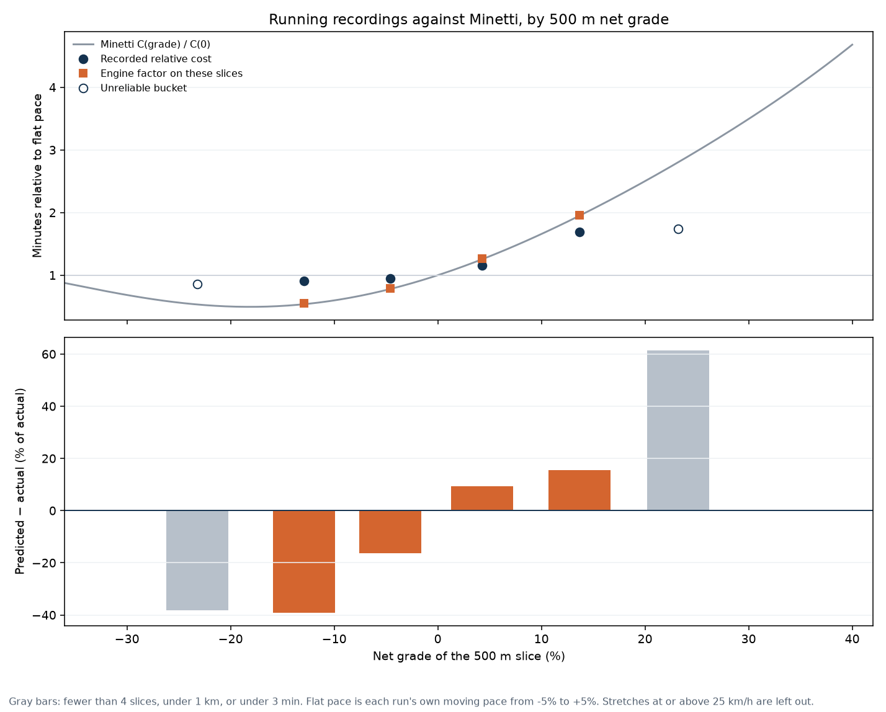

# Minetti on these trails

Engine constants were not changed. This report only reads them.

The question was whether recorded moving time, sliced the way the engine slices a course, follows Minetti's relative cost `C(grade) / C(0)`. On the two clocks that are actually runs, the whole-course error is small and the shape is not. Descents take much longer than Minetti, and climbs take a bit less. Steeper than about −20% and steeper than about +20% do not have enough trail here to say anything.

## Which files have a clock

| File | Track `<time>` | Used for the comparison |
| --- | --- | --- |
| `frontend/data/gpx/salomon-vitosha-12.gpx` | Every point, 2018-05-27 07:00–08:06 | Yes |
| `frontend/data/gpx/salomon-vitosha-27.gpx` | Every point, 2018-05-27 07:30–09:51 | Yes |
| `frontend/data/gpx/salomon-vitosha-40.gpx` | Every point, 2018-05-27 07:30–11:40 | No. 11.39 km is held at 25 km/h or faster |
| `frontend/data/gpx/vitosha-100.gpx` | None | No |

The 40 km file is a timestamped GPX, and it is not a running effort. 11.39 km (19.1 min) stays at or above 25 km/h for stretches of at least 200 m, at 1.6–1.8 min/km, including 0.79 km on 0% to +10%. Median speed is 14 km/h, the 90th percentile is 39 km/h, and the maximum is 50 km/h. It also has 2,296 steps with a non-positive timestamp. Those fast kilometres were left out of the pool. The grade table for this file in `docs/calibration/pace-by-grade.txt` drops them, so that table is not a Minetti test.

No file produced an aid-station dwell. Stopped time under 1 km/h was 0.0 min, 0.5 min, and 0.0 min. There was almost nothing to remove.

## How the comparison was made

Each recording was cut with the engine's own `prepare_course` and `slice_segments` (about 500 m, net grade). Moving time keeps steps at or above 1 km/h. Isolated jumps are dropped: a stretch of at most 80 m whose fastest step is at least 30 km/h (10 m on the 12 km, 8 m on the 27 km).

Flat pace is that recording's own moving pace on slices graded −5% to +5%: 4.29 min/km on the 12 km (from 4.23 km) and 4.73 min/km on the 27 km (from 10.80 km). Predicted minutes are moving kilometres times that pace times `gap_cost_factor(slice grade)`.

Error is predicted minus actual. A negative error means the engine's clock is too fast.

A bucket is unreliable when it has fewer than 4 slices, under 1 km of moving distance, or under 3 minutes of moving time. The open circles and gray bars in the chart are those buckets.

## What the two runs show

Together the 12 km and the 27 km are 206.5 moving minutes. Given each run's own flat pace, the engine's pooled error is **4.8 minutes fast, −2.3%**. The 12 km alone is 4.9 minutes fast (−7.5%). The 27 km alone is 0.2 minutes slow (+0.1%). The totals cancel. The grade buckets do not.

Relative cost below is recorded minutes divided by flat-pace minutes. Minetti is the distance-weighted engine factor on the same slices.

| Grade | Moving | Slices | Recorded cost | Minetti | Error |
| --- | ---: | ---: | ---: | ---: | ---: |
| −30..−20 | 0.50 km, 2.0 min | 1 | 0.86 | 0.53 | −0.8 min (−38%), unreliable |
| −20..−10 | 5.50 km, 22.7 min | 11 | 0.90 | 0.55 | −8.9 min (−39%) |
| −10..0 | 16.02 km, 69.7 min | 33 | 0.94 | 0.79 | −11.3 min (−16%) |
| 0..+10 | 9.50 km, 49.8 min | 19 | 1.15 | 1.26 | +4.6 min (+9%) |
| +10..+20 | 7.50 km, 58.2 min | 15 | 1.69 | 1.96 | +9.1 min (+16%) |
| +20..+30 | 0.50 km, 4.1 min | 1 | 1.74 | 2.80 | +2.5 min (+61%), unreliable |



Both runs tell the same story, which is why the pool is not one file wearing the other's numbers.

| Grade | 12 km recorded vs Minetti | 27 km recorded vs Minetti |
| --- | --- | --- |
| −20..−10 | 0.99 vs 0.54 (−3.8 min) | 0.86 vs 0.55 (−5.0 min) |
| −10..0 | 0.95 vs 0.75 (−3.6 min) | 0.94 vs 0.80 (−7.8 min) |
| 0..+10 | 1.19 vs 1.28 (+1.5 min) | 1.13 vs 1.25 (+3.1 min) |
| +10..+20 | 1.83 vs 1.92 (+1.0 min) | 1.63 vs 1.97 (+8.1 min) |

On −20% to −10%, Minetti says the slice should take about half of flat time. Both runs took 0.86–0.99 of flat time, close to level-ground pace. On −10% to 0% the miss is the same direction and smaller. From 0% to +20% the runners were a little faster than Minetti. The 12 km climb miss is small (+1.0 min on +10..+20). The 27 km climb miss is larger (+8.1 min). Neither run was slower than Minetti on a climb bucket that has enough samples.

Today's cost floor of 1.0 J/kg/m does not bind on these grades. The polynomial's low point in the table is 0.50 at −20%, which is 1.80 J/kg/m. A floor has to rise past that before any slice in this set changes.

## What this does not show

These are two recordings from the same morning on Vitosha, not two mountains and not a season of athletes. 67% of sampled points on the 12 km lie within 25 m of the 27 km track. Their clocks also overlap for about half an hour. Flat paces differ (4.29 vs 4.73 min/km), so they are not one effort counted twice, and they are not independent either.

The grade is the engine's 500 m net grade. A short steep pitch inside a milder slice never appears as its own bucket. That is the right test of this engine, and a weak test of foot-by-foot Minetti.

There is one 500 m slice steeper than −20% and one steeper than +20%. Both are marked unreliable. Nothing here supports a claim about −30% scree or a +25% hike.

## Candidate adjustments

None of these were applied. Error figures are predicted minus actual on the two running recordings (206.5 moving minutes).

### 1. Descent floor

Raise `MIN_COST_J_PER_KG_M` from 1.0. The factor floor is that number divided by 3.6.

| Floor | Whole clock | Grade under −10% | −10% to 0% | Climbs |
| --- | ---: | ---: | ---: | --- |
| 1.0 (today) | −4.8 min (−2.3%) | −9.6 min | −11.3 min | unchanged |
| 1.6 J/kg/m | −4.8 min | −9.6 min | −11.3 min | unchanged |
| 2.0 J/kg/m | −4.3 min | −9.2 min | −11.3 min | unchanged |
| 2.5 J/kg/m | +0.2 min (+0.1%) | −5.6 min | −10.3 min | unchanged |
| 3.2 J/kg/m | +12.6 min (+6.1%) | −0.3 min | −3.3 min | unchanged |

1.6 does nothing, because the polynomial on these slices never falls below 1.6. 2.0 only clips the bottom of the curve and moves the steep-descent error by 0.4 min. 2.5 makes the whole clock look right (+0.2 min) while leaving the shape wrong: steep descents are still 5.6 minutes too fast and mild descents 10.3 minutes too fast. The total only balances because the climbs are already predicted long.

A floor of 3.24 J/kg/m (factor 0.90) is the value that zeros the grade-under-−10% group. 3.2 is the round version. On these two runs it removes the steep-descent miss (−9.6 min to −0.3 min) and cuts the mild-descent miss from −11.3 min to −3.3 min. The whole clock then swings from 4.8 minutes fast to 12.6 minutes slow, because the climb surplus is left in place and the floor also nudges the downhill side of the −5% to +5% anchor (that window moves from −2.4 min to −0.8 min).

### 2. Steep-climb hiking factor

Multiply cost once the net grade reaches a hiking threshold. The recordings do not support a factor above 1.

On grade at least +15% (26.8 moving minutes) the engine is already 5.4 minutes slow. The multiplier that would zero that group is 0.83, a speed-up. The +20% fit is 0.62, and that group is one unreliable slice (4.1 min), so it is not a result.

| Adjustment | Whole clock | Grade at least +15% | Descents |
| --- | ---: | ---: | --- |
| ×1.25 above +15% | −4.8 → +3.3 min | +5.4 → +13.5 min | unchanged, still about 21 min fast |
| ×1.40 above +15% | −4.8 → +8.1 min | +5.4 → +18.3 min | unchanged |
| ×1.25 above +20% | −4.8 → −3.1 min | +5.4 → +7.1 min | unchanged |

A hiking penalty would add time these runners did not take, and it would leave the descent miss untouched. The +10% to +20% bucket is the one with enough samples, and both runs are at or under the Minetti factor there (1.83 vs 1.92, and 1.63 vs 1.97).

### 3. Terrain technicality

Two knobs were scored. Level 0 leaves Minetti as it is.

Descent-only: at or below −8%, move the factor toward flat cost and never make a descent faster than Minetti. Climbs stay on the polynomial. At level 1.0 the downhill discount below −8% is gone.

| Adjustment | Whole clock | Under −10% | −10% to 0% | At least +15% |
| --- | ---: | ---: | ---: | ---: |
| Descent-only, level 1.0 | +12.7 min (+6.1%) | −9.6 → +2.7 min | −11.3 → −6.3 min | unchanged at +5.4 min |
| Two-sided, level 0.5 | +10.4 min (+5.0%) | −9.6 → −3.4 min | −11.3 → −8.8 min | +5.4 → +11.9 min |
| Two-sided, level 1.0 | +25.5 min (+12.4%) | −9.6 → +2.7 min | −11.3 → −6.3 min | +5.4 → +18.3 min |

The two-sided knob also multiplies grades at or above +15% by `1 + 0.40 × level`. That climb half makes the existing climb surplus worse, same as the hiking factor.

Descent-only level 1.0 is close to the 3.2 J/kg/m floor and a little past the recordings. Steep descents were at cost 0.90, not 1.00, so wiping out the whole discount overshoots that group by 2.7 minutes. Grades between −8% and 0% are left alone, so 6.3 minutes of the mild-descent miss remains. The whole clock goes to +12.7 minutes for the same reason as the high floor: climbs are not sped up.

## Where the numbers are

`scripts/calibrate_pace.py` writes `docs/calibration/pace-by-grade.csv`, `docs/calibration/pace-by-grade.txt`, and `docs/calibration/pace-by-grade.png`. Matplotlib draws the chart and is not an app dependency.

```text
.\.venv\Scripts\python.exe scripts\calibrate_pace.py
```
